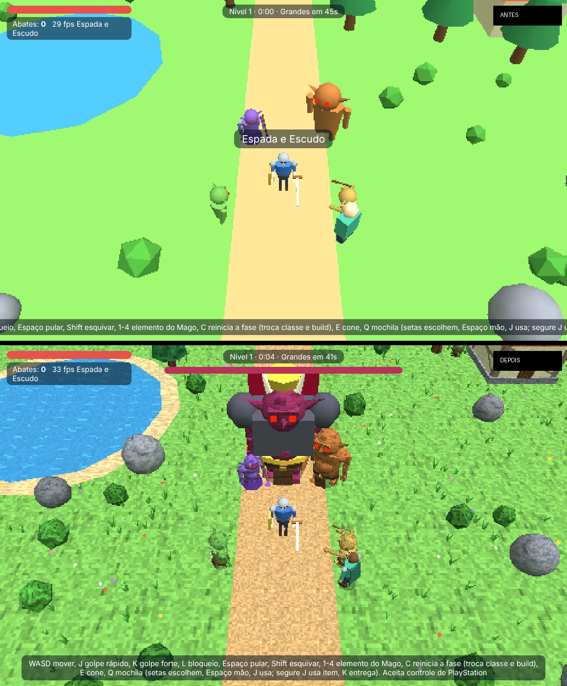

# Arena de Honra

Action RPG de horda em 3D low-poly (estilo PS1) que roda direto no navegador,
no PC e no celular. Escolha raça, classe e build, sobreviva às ondas de
inimigos, derrote o boss de cada nível e jogue com amigos pelo multiplayer
online P2P.

> Esta é a versão de testes, preparada para ser aberta e evoluída no
> [OhMyGame](https://github.com/WhiteTowerAI/ohmygame). O projeto original
> continua guardado, sem alterações, em `arena-de-honra-meior`.

## Como jogar

Abra o `index.html` no navegador. Para instalar como app no celular, ou para
o multiplayer funcionar direito, sirva a pasta por HTTP, por exemplo:

```sh
npx serve .
# ou
python3 -m http.server 8000
```

| Ação | Teclado | Controle (PlayStation) |
| --- | --- | --- |
| Mover | WASD / setas | Analógico esquerdo |
| Golpe rápido / forte | J / K | ○ / △ |
| Bloqueio (parry no tempo certo) | L | □ |
| Pular | Espaço | ✕ |
| Esquivar | Shift | R1 |
| Mochila | Q | L1 |
| Elemento do Mago | 1–4 | Direcional |
| Reiniciar a fase (troca classe e build) | C, ou no menu de pausa | Share |
| **Pausar** | **Esc / P** | — |
| Cone de flechas (só Arco) | E | R2 |
| **Girar a câmera** | Clique na tela e mova o mouse | Analógico direito |

No celular os botões seguem o padrão do PPSSPP: L1 e R1 nos cantos de cima, △○✕□ em losango à direita, SELECT (Arma, só no Mago) e START (Pausa) embaixo no meio; Reiniciar fica no menu de pausa. Em *Configurações → Botões na tela → Editar layout* dá para arrastar cada botão e analógico para onde quiser, mudar o tamanho de cada um e de todos de uma vez, ajustar a transparência e escolher se o analógico de movimento é flutuante (aparece onde você toca) ou fixo. As posições ficam salvas em % da tela, então funcionam em celulares e tablets de tamanhos diferentes. O jogo roda deitado (tela cheia), com analógico de movimento à esquerda, analógico da câmera (📷) à direita e botões na tela; também dá para arrastar a tela para girar a câmera, e o analógico da câmera pode ser desligado nas configurações. As teclas podem ser trocadas
em **Configurações**.

## O que mudou em relação ao original

- **Nome e ícone:** o jogo se chama Arena de Honra em toda parte e tem ícone próprio.
- **Instalável:** dá para adicionar à tela inicial do celular (PWA), em tela cheia e na horizontal.
- **Pausa:** Esc ou P pausam o single player. O jogo também pausa sozinho quando você troca de aba. O multiplayer não pausa.
- **Números de dano:** cada golpe e cada magia mostra quanto tirou do inimigo, e golpes fortes aparecem em amarelo.
- **Recorde:** o jogo guarda seu melhor número de abates e o nível mais alto, e mostra os dois na tela de derrota e no menu.
- **Ajuda:** a barra de controles agora quebra linha em vez de sair da tela, e some depois de 15 s de partida. Ela continua aparecendo na tela de pausa.
- **Gráficos estilo PS1 (opcional, desligado por padrão):** os vértices "tremem" presos à grade de pixels e as cores usam dithering de 15 bits, tudo feito no próprio shader, sem custo extra. As texturas pixeladas (grama, terra, água animada, madeira, telhas, tijolo, pedra, tecido, pele) são geradas na hora, sem baixar nenhuma imagem.
- **Modelos mais detalhados:** os inimigos ganharam mandíbula, presas, sobrancelha, nariz, cotovelos, mãos com garras, pés, cinto, tanga e espinhos nas costas. Como cada parte vira uma malha só, eles ficaram mais leves que antes. O aliado também tem modelo novo, com capa, e as casas ganharam alicerce e lintel.
- **Cenário:** tem grama e flores divididas em blocos (só é desenhado o que aparece na tela), margem de areia no lago, sombra redonda embaixo dos personagens e variação de cor entre árvores e pedras.
- **Animações de ataque:** cada golpe agora tem antecipação (a arma recua), um movimento rápido com aceleração e um follow-through que volta suave. O corpo gira e se inclina junto, e as pernas firmam a postura. No golpe forte o personagem levanta a arma acima da cabeça e agacha ao bater. O estocada recua antes de avançar. Os braços balançam ao andar, o personagem respira parado e encolhe as pernas no pulo.
- **Efeitos:** rastro brilhante da arma com a cor de cada uma, faíscas e pedaços ao acertar, explosão de pedaços ao matar (maior no boss), estouro dourado no parry, poeira ao esquivar e ao pousar, e o inimigo "amassa" ao apanhar. As partículas são todas desenhadas de uma vez (1 chamada de desenho).
- **Jogador e animal:** o jogador ganhou boca, gola, fivela, túnica, braçadeiras, joelheiras e cano das botas. O animal tem corpo novo, com focinho, olhos, presas, cauda, pelo texturizado (o tigre tem listras) e patas que andam de verdade.
- **Armas realistas:** espada com guarda, empunhadura de couro, pomo e lâmina afiada com sulco; espada longa de duas mãos; machado com lâmina em meia-lua e fio claro; arco curvo com corda; lança com lâmina em folha e ponteira; adagas; cajado com aro dourado; martelo de guerra com faixas e espigão; escudo redondo com bossa e cruz. Os arqueiros inimigos também usam o arco novo.
- **Animações dos inimigos:** o passo segue a velocidade real (parado, eles respiram) e os braços balançam ao contrário das pernas. Eles se inclinam ao correr, para trás ao preparar o golpe, e avançam o corpo ao bater. Ao apanhar, são empurrados para trás. Tontos, eles cambaleiam; arremessados, se debatem. Ao morrer, piscam, caem de costas, escurecem e afundam no chão.
- **Câmera no ombro (estilo ação em 3ª pessoa):** a câmera fica atrás do ombro do personagem e o movimento é relativo a ela. Ela segue sozinha quando você corre, desvia das casas e esconde as árvores que ficam na frente. A visão de cima continua disponível nas configurações.
- **Visual inspirado em "3D pixel art":** contorno escuro de 1 pixel, sombras reais em pixel com o sol acompanhando o jogador, sol quente com sombra azulada, céu em degradê, rua de paralelepípedo e casas com janelas e floreiras.
- **Raças com visual próprio:** todas usam o mesmo esqueleto, mas cada uma tem proporção, rosto e cabelo diferentes (veja `docs/racas.png` e `docs/corpos.png`). O rosto é pintado numa textura feita para cada raça: pele, olhos com íris colorida, brilho e cílios, sobrancelhas, bochechas, nariz e boca. O Troll e o Goblin têm pupila em fenda, o Meio-orc tem uma cicatriz e o Goblin tem sardas. As peças do corpo são mais arredondadas, e as mãos e as botas deixaram de ser caixas. A túnica é pintada com gola, botões, costuras, dobras e barra; a calça tem costura e joelheira, e a bota tem cadarço.
  - **Humano:** cabelo curto com franja.
  - **Elfo:** orelhas longas para trás, corpo esguio, cabelo longo loiro e olhos verdes.
  - **Anão:** baixo e largo, careca, barba e bigode grandes.
  - **Gnomo:** bem baixinho, cabeça grande, nariz redondo, topete e bigode brancos.
  - **Meio-orc:** pele verde, mais largo, presas, sobrancelha pesada e moicano.
  - **Troll:** pele azul, alto, nariz comprido, presas grandes, orelhas caídas e cabelo laranja selvagem.
  - **Minotauro:** chifres, focinho com argola, orelhas de touro, grande e forte.
  - **Goblin:** pequeno, verde, orelhas enormes, nariz pontudo, dentes afiados e olhos amarelos.
- **Proporções por raça (estilo WoW Classic):** todas usam o mesmo esqueleto, mas com tronco, ombros, braços, pernas, cabeça e postura próprios (veja `docs/racas-corpo.png`). O anão é baixo e largo; o gnomo, minúsculo e cabeçudo; o meio-orc, largo, de mãos grandes e ombros caídos; o troll, alto, magro, de braços longos e curvado; o minotauro, enorme; e o goblin, o menor de todos. As armas e o escudo acompanham o tamanho de cada um.
- **Balanceamento:** o Monge ganha +60% de dano no single player, porque no multiplayer ele é suporte. O Mago de Gelo ganhou um pouco de dano. Os arqueiros inimigos atiram mais devagar, erram mais e o jogador tem 20% de chance de evadir as flechas. O chefe agora arremessa inimigos menores (com marca no chão) e golpeia o chão com uma onda de choque que atordoa; dá para pular a onda ou esquivar. Veja `docs/balanceamento.md`.
- **Animação de combate refeita (braços com ombro, cotovelo e mão):** a arma agora fica de verdade na mão. Cada golpe define o caminho da mão e da lâmina, e o ombro, o cotovelo e a mão são calculados para acompanhar (cinemática inversa). A articulação do ombro avança com o alcance, o tronco gira sobre as pernas e a cabeça continua olhando para frente. Espada longa, lança e martelo são segurados com as duas mãos; o escudo vai no braço e sobe no bloqueio; o arco é puxado ao atirar; o Monge fica em guarda e soca com o braço certo. O personagem passou a ser destro. Os outros jogadores no multiplayer usam o mesmo sistema. Veja `docs/animacoes.png`.
- **Paladino com martelo pesado:** o martelo é segurado com as duas mãos o tempo todo. Parado, a cabeça do martelo descansa no chão. Nos golpes, as mãos ficam juntas perto do peito, o cabo varre largo, o tronco gira e inclina junto e o personagem agacha no impacto; os movimentos têm um atraso de peso. Veja `docs/paladino.png`.
- **Monge (antigo Pugilista):** a classe mudou de nome e de visual, com as mesmas habilidades. Túnica laranja, faixa vermelha na cintura e no peito, colar de contas, faixas de pano nos antebraços e postura de artes marciais. Veja `docs/monge.png`.
- **Sem aliado no single player:** o boneco de capa verde que seguia o jogador era só um teste do começo do projeto e foi removido. O que dependia dele mudou: o teleporte do Mago de Ilusão agora salta para longe do inimigo mais perto, o "puxar aliado" do Paladino vira um escudo sagrado (+25), o L1 do Necromante abre a mochila, o orbe do Monge cura você, e o bônus do Minotauro vira +8% de cura em você. No multiplayer, essas habilidades continuam valendo para os outros jogadores.
- **Multiplayer completo:** cada jogador vê os outros com o personagem detalhado (raça, proporções, rosto, classe, armas e escudo) e com as mesmas animações: golpes com antecipação, corrida, pulo, esquiva e bloqueio. Também chegam pela rede:
  - os projéteis (flechas, magias, martelo, soco à distância, orbe) e os efeitos de área;
  - as invocações do Necromante e o animal do Arqueiro;
  - as faíscas e os números de dano quando outro jogador acerta um inimigo, e a queda dos inimigos ao morrer;
  - a altura dos inimigos arremessados e os dois ataques do chefe (aviso, onda e arremesso), que acertam e atordoam qualquer jogador.
- **Ajustes de kit (rodada 3):**
  - **Adagas:** a esquiva gasta 40 de estamina (a barra amarela) e demora mais para recarregar.
  - **Dois Machados:** cada inimigo eliminado devolve 6 de vida.
  - **Mago de Fogo:** explodir um inimigo queimado causa dano em área nos vizinhos. A bola de fogo é um projétil maior, atravessa até 3 inimigos e cada acerto causa dano em área e queima os vizinhos.
  - **Mago de Gelo:** acertar o projétil num inimigo lento ou enfraquecido congela na hora; a nevasca congela os enfraquecidos; o estilhaçar pega lentos, enfraquecidos e congelados, com dano maior nos congelados.
  - **Mago de Ilusão:** invoca 3 clones de verdade (fogo, gelo e sombra), que andam, escolhem alvos e usam magias sozinhos por 14 s. Os inimigos os atacam e eles somem com um golpe. No online funciona igual para quem hospeda e para quem entra: todos veem os clones (como cópias do personagem do dono), e os inimigos os atacam e derrubam.
- **Desistir da run:** no menu de pausa, encerra a partida e mostra o resumo com o recorde.
- **Personagens VRoid (opcional, desligado por padrão):** em *Configurações → Boneco 3D (VRoid)* o jogador pode trocar o boneco por um modelo VRM, com animação própria de corpo humano e o visual de cada classe por cima. Nada é baixado enquanto a opção estiver desligada. Veja `modelos/LEIA-ME.md`.
- **Mira dos projéteis:** facas, magias, martelo arremessado, rajada de flechas, soco à distância e orbe sombrio miram primeiro no inimigo sob o mouse. Com o mouse capturado, no analógico, no controle ou no toque, vale o centro do olhar (a mira no meio da tela); na câmera de cima, a frente do personagem. Sem ninguém na mira, vão no mais forte (boss, depois os grandes) e, se forem todos iguais, no mais perto. Um anel vermelho marca o inimigo na mira.
- **Celular:** botões no padrão do PPSSPP e editor de layout (posição, tamanho e transparência de cada botão), analógico de câmera, tela cheia na horizontal e aviso para girar o aparelho.
- **Opções para deixar leve:** Sombras, Contorno, Efeitos de golpe, Grama e flores e Visual PS1 podem ser desligados. No celular as sombras já começam desligadas.
- **Projeto OhMyGame:** o repositório tem `ohmygame.json`, um documento de design (`docs/design.md`) e regras para o agente (`AGENTS.md`).

## Abrindo no OhMyGame

1. Instale o OhMyGame (macOS ou Windows) pelo site oficial.
2. Clone este repositório e use **Abrir pasta**. O `ohmygame.json` faz o
   app reconhecer o projeto como *General Game*.
3. Em **Project settings → Web preview**, escolha o modo *Static files*: o
   jogo é um único `index.html` e não precisa de instalação.
4. Peça mudanças no chat. O agente lê o `AGENTS.md` e o `docs/design.md`
   antes de mexer no código, e pode jogar o jogo para conferir o resultado.



## Estrutura

```
index.html             o jogo inteiro (HTML + CSS + JS, three.js r128 e PeerJS via CDN)
manifest.webmanifest   dados do app instalável
icon.svg               ícone
ohmygame.json          tipo do projeto para o OhMyGame
modelos/               personagens VRoid (.vrm) e instruções
docs/design.md         documento de design do jogo
AGENTS.md              regras para agentes de código (OhMyGame, Claude Code, Codex…)
```
